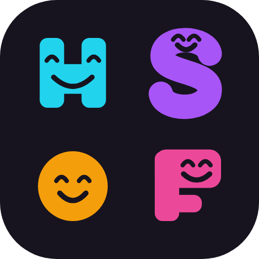

# Agent Crew

*[Read in English](README.md)*

Un mod de Claude Code que te deja **ver a tus subagentes trabajando** y le da a cada proyecto **un equipo de subagentes hecho para él**, que se mantiene al día a medida que el proyecto cambia. Funciona en la extensión de Claude Code para VS Code y en la app de escritorio de Claude.



## Qué hace

**Un panel con tus subagentes.** Cada subagente en marcha aparece como un personaje animado: la inicial de su modelo con cara. H es Haiku (da saltitos), S es Sonnet (se balancea), O es Opus (respira despacio) y F es Fable (flota). Cada uno tiene su color, y al lado ves su nombre, su modelo y lo que está haciendo en ese momento, por ejemplo *Leyendo server.py* o *Buscando «parse_config»*. Cuando acaba, sonríe y pasa a *Terminados* con lo que ha tardado y los pasos que ha dado. **Ver** abre su conversación.

**Un botón para abrirlo y cerrarlo.** Una franja fina encima de donde escribes muestra *Agent Crew* y cuántos subagentes hay en marcha. Pulsa para abrir o cerrar el panel; no hace falta escribir ningún comando.

**Subagentes hechos para tu proyecto.** La primera vez que abres un proyecto, Agent Crew te pregunta si puede analizarlo. Si dices que sí, un subagente arquitecto que solo lee estudia el proyecto y diseña entre 2 y 6 especialistas, cada uno con el modelo más barato que hace bien su trabajo. Se guardan en `.claude/agents/`, donde puedes leerlos, editarlos y compartirlos. Mientras trabajas, Claude les pasa las tareas que encajan con ellos, y eso ahorra uso.

**Siempre al día.** Cuando el proyecto ha cambiado bastante (unos 20 commits, o dos semanas con trabajo nuevo), Agent Crew revisa el equipo en segundo plano y te dice qué ha creado, cambiado o quitado. Solo toca los archivos que escribió él. Si editas uno, conserva tu versión. Los que ya no hacen falta van a la papelera; nunca se borra nada para siempre.

**En español y en inglés.** El panel sigue el idioma de tu sistema. Las descripciones de los subagentes que escribe siguen el idioma en el que sueles escribir a Claude, o el del sistema mientras no lo sabe. Puedes elegir un idioma para todo en sus ajustes.

## Instalarlo

En el prompt de una sesión de Claude Code en la terminal:

```
/plugin install agent-crew --marketplace TomPi-2/agent-crew
```

Contesta `y` para añadir el marketplace y elige dónde instalarlo (en el ámbito de usuario lo tendrás en todos tus proyectos). Desde una consola:

```
claude plugin install agent-crew --marketplace TomPi-2/agent-crew
```

En la app de escritorio, donde `/plugin` no funciona: pulsa **+** junto a la caja del prompt, después **Plugins**, **Add marketplace** con `TomPi-2/agent-crew` y luego **Add plugin**.

**Actualizaciones.** Claude Code no actualiza solo los plugins de este marketplace si no se lo pides. Para recibir las versiones nuevas automáticamente, ejecuta `/plugin`, abre **Marketplaces**, elige `agent-crew` y activa la actualización automática. Para actualizar una vez, ejecuta `claude plugin update agent-crew@agent-crew` en una terminal y después `/reload-plugins` en tu sesión.

## Usarlo

- **Panel:** el botón *Agent Crew* encima del prompt, o `/crew`.
- **Revisar ahora el equipo de un proyecto:** *Revisar ahora* en el panel, o `/crew-review`. En un proyecto que aún no has configurado, primero pregunta.
- **Ajustes** (en la configuración del plugin):
  - `language`: `auto`, `en` o `es`. Fija el del panel y el de las descripciones de los subagentes.
  - `analysisModel`: el modelo del arquitecto (`sonnet` por defecto).
  - `autoReview`: mantener el equipo al día solo (activado por defecto).

## Qué pregunta y qué toca

- Pregunta antes de analizar un proyecto. Puedes contestar *Sí*, *Ahora no* o *Nunca en este proyecto*. Siempre puedes configurarlo más tarde desde el panel.
- El arquitecto solo puede leer el proyecto (Read, Grep, Glob). Los archivos los escribe Agent Crew, y solo en `.claude/agents/`.
- Sus archivos llevan la marca `<!-- agent-crew:generated -->`. Los que no la llevan (tus propios agentes) nunca se cambian ni se quitan.
- Añade una nota corta al prompt del sistema de Claude con la lista del equipo del proyecto. En ella le pide que les pase las tareas acotadas y que se quede con el diseño, los cambios importantes, la seguridad y las revisiones.
- Mira lo que escribes a Claude solo para saber si escribes en español o en inglés. Guarda un recuento por idioma, nunca el texto.
- Usa `git` para saber dónde empieza el proyecto y cuánto ha cambiado. En Windows también usa PowerShell, para leer el idioma del sistema y para mandar archivos a la papelera.

## Licencia

[MIT](LICENSE)
